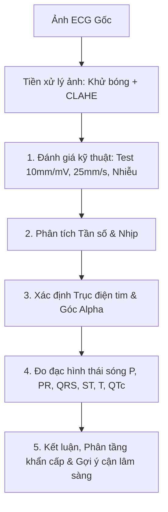

# 🫀 AI 12-Lead ECG Expert

<div align="center">


**Hệ thống trợ lý AI hỗ trợ phân tích điện tâm đồ 12 chuyển đạo tiêu chuẩn theo thời gian thực.**  
Tích hợp thuật toán xử lý ảnh y sinh nâng cao (khử bóng mờ, tăng tương phản lưới mm, căn góc xoay) kết hợp mô hình thị giác đa phương thức thế hệ mới.

[Trải nghiệm trực tuyến](#-triển-khai-nhanh-lên-streamlit-cloud) • [Tính năng nổi bật](#-tính-năng-cốt-lõi) • [Quy trình đọc ECG](#-quy-trình-phân-tích-chuẩn-y-khoa) • [Tuyên bố miễn trừ](#-tuyên-bố-miễn-trừ-trách-nhiệm-disclaimer)

---

</div>

## 📌 Tổng quan

**`ECG-analysis-by-drLai`** là ứng dụng web mã nguồn mở được xây dựng nhằm hỗ trợ bác sĩ lâm sàng, nhân viên y tế và sinh viên y khoa trong việc đọc nhanh bản ghi điện tâm đồ 12 đạo trình. Ứng dụng giải quyết các thách thức phổ biến của ảnh chụp ECG lâm sàng: bản in nhiệt bay màu, thiếu sáng, đổ bóng tay/điện thoại, méo góc và hỗ trợ đa dạng định dạng từ iOS/Android (`HEIC`, `JFIF`, `PNG`, `JPG`).

---

## ✨ Tính năng cốt lõi

### 1. 🔬 Bộ tiền xử lý hình ảnh y tế tự động (OpenCV Pipeline)
* **Khử bóng mờ & Đồng đều nền quang học:** Tách lớp nền bằng bộ lọc hình thái học (Morphological Closing) và Gaussian Blur để loại bỏ bóng đổ của điện thoại khi chụp tại giường bệnh.
* **Cân bằng tương phản cục bộ thích ứng (CLAHE):** Tăng cường độ nét của đường lưới mm và các sóng biên độ thấp (sóng $P$, sóng $U$, khấc $J$, sóng delta) mà không làm lóa nền.
* **Tăng cường nét viền (Unsharp Masking):** Khôi phục nét in cho các bản in nhiệt cũ bị mờ nhạt.
* **Cân góc xoay kỹ thuật số:** Cho phép xoay mịn theo từng góc độ để đưa đường đẳng điện về chuẩn song song nằm ngang.

### 2. ⚡ Động cơ AI phân tích đa phương thức (Multimodal Inference)
* **Streaming thời gian thực:** Chữ xuất hiện liên tục ngay từ giây đầu tiên, loại bỏ hiện tượng treo nghẽn kết nối mạng.
* **Mặc định miễn phí:** Tích hợp `gemini-3.8-flash` với độ trễ thấp và khả năng nhận diện hình ảnh y khoa chính xác.
* **Chế độ đối chiếu chuyên sâu:** Hỗ trợ nhập API key cá nhân để kích hoạt `OpenAI GPT-4o` hoặc chạy song song so sánh kết quả giữa hai mô hình lớn nhất thế giới.
* **Hỗ trợ ngữ cảnh bệnh án:** Cho phép nhập tuổi, giới tính và bệnh sử (cơn đau thắt ngực, tiền căn rối loạn nhịp...) để AI biện luận sát thực tế lâm sàng.

### 3. 📱 Tương thích đa nền tảng
* Nhận diện mượt mà ảnh chụp trực tiếp từ camera điện thoại, ảnh xuất từ màn hình monitor hoặc file ảnh định dạng `.heic` / `.heif` đặc thù của Apple iPhone.

---

## 🩺 Quy trình phân tích chuẩn y khoa

Mô hình được huấn luyện bằng Prompt lâm sàng chuyên sâu, tuân thủ nghiêm ngặt 5 bước đọc điện tâm đồ của Hội Tim Mạch:



### Bảng phân vùng giải phẫu 12 chuyển đạo đối chiếu:

| Vùng thành tim | Chuyển đạo khảo sát | Nhánh động mạch vành gợi ý |
| :--- | :--- | :--- |
| **Trước vách (Anteroseptal)** | $V_1, V_2$ | ĐM liên thất trước (LAD - Đoạn gần) |
| **Trước mỏm (Anterior/Apical)** | $V_3, V_4$ | ĐM liên thất trước (LAD) |
| **Thành bên (Lateral)** | $I, aVL, V_5, V_6$ | ĐM mũ (LCx) hoặc nhánh chéo (Diagonal) |
| **Thành dưới (Inferior)** | $II, III, aVF$ | ĐM vành phải (RCA) hoặc ĐM mũ (LCx) |
| **Thành sau thực thụ (Posterior)** | Soi gương ở $V_1 - V_3$ ($R$ cao, $ST$ dốc xuống) | Nhánh liên thất sau (PDA) |
| **Thất phải (Right Ventricle)** | $V_3R, V_4R$ | ĐM vành phải (RCA đoạn gần) |

---

## 📂 Cấu trúc thư mục

```text
ECG-analysis-by-drLai/
├── .streamlit/
│   └── secrets.toml          # Chứa API key môi trường local (không đẩy lên Git)
├── app.py                    # Mã nguồn chính (Giao diện, OpenCV, Streaming AI)
├── requirements.txt          # Danh sách thư viện phụ thuộc
└── README.md                 # Tài liệu hướng dẫn dự án
```

---

## 🚀 Triển khai nhanh lên Streamlit Cloud

### 1. Fork hoặc Clone repository
```bash
git clone https://github.com/Drxuanlai/ECG-analysis-by-drLai.git
cd ECG-analysis-by-drLai
```

### 2. Cài đặt môi trường chạy cục bộ (Local Testing)
Khuyến nghị sử dụng **Python 3.10** hoặc **3.11**:
```bash
python -m venv venv
source venv/bin/activate      # Trên Windows dùng: venv\Scripts\activate
pip install -r requirements.txt
streamlit run app.py
```

### 3. Cấu hình biến môi trường Secrets
Khi triển khai trên **[Streamlit Community Cloud](https://share.streamlit.io)**, thêm khóa API vào mục **Settings $\rightarrow$ Secrets**:
```toml
GEMINI_API_KEY = "AQ.Ab..."
# OPENAI_API_KEY = "sk-proj-..."  (Tùy chọn nếu muốn bật sẵn GPT-4o cho hệ thống)
```

---

## ⚠️ Tuyên bố miễn trừ trách nhiệm (Disclaimer)

> **LƯU Ý QUAN TRỌNG:**  
> 1. Ứng dụng này là một công cụ nghiên cứu khoa học và hỗ trợ học tập, **hoàn toàn không thay thế cho đánh giá chuyên môn của bác sĩ tim mạch hoặc quyết định điều trị lâm sàng**.
> 2. Người sử dụng cần tự chịu trách nhiệm đối với các thông tin chẩn đoán dựa trên kết quả gợi ý từ trí tuệ nhân tạo.
> 3. Không tải lên các hình ảnh có chứa thông tin định danh cá nhân nhạy cảm của người bệnh (tên, số CMND/CCCD, mã hồ sơ bệnh án) để đảm bảo tuân thủ tiêu chuẩn bảo mật y tế (HIPAA).

---

## 👨‍⚕️ Tác giả & Đóng góp

* **Chủ nhiệm dự án:** BS. Xuân Lai ([@Drxuanlai](https://github.com/Drxuanlai))
* **Lĩnh vực:** Ứng dụng Trí tuệ Nhân tạo & Xử lý Tín hiệu Hình ảnh trong Y sinh học.

Mọi đóng góp (Pull Request), báo cáo lỗi (Issue) hoặc đề xuất tính năng mới luôn được hoan nghênh nồng nhiệt!